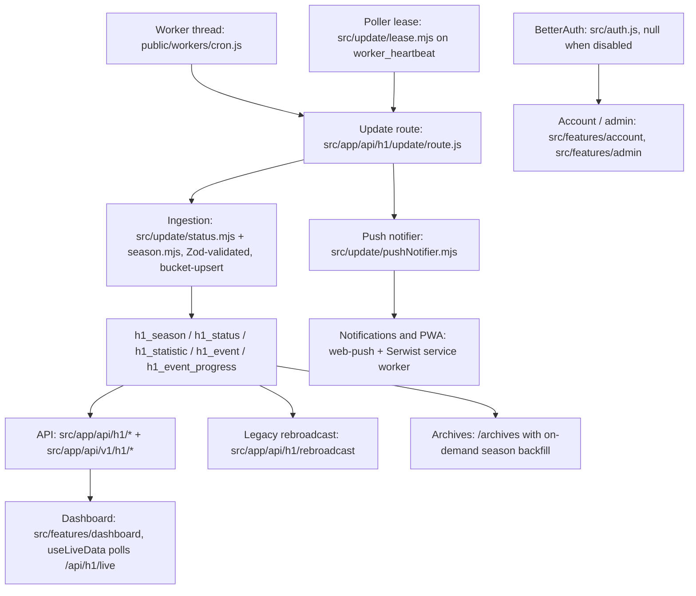

# helldivers.bot architecture

helldivers.bot is a Next.js 16 App Router monolith around a normalized Postgres schema, fed by an
in-process worker thread that polls the official Helldivers 1 API. There is no separate backend
service: the "worker" is a `worker_threads` thread inside the same Next.js server process, and
multi-replica deployments coordinate through a database-row lease, not a message queue.

**eli14:** The app is a single restaurant kitchen. One stove (the Postgres lease row) decides which
of the many identical kitchens cooks tonight — so the meal is never prepared twice. Whatever the
stove cooks is chopped into fixed-size time buckets and stored in five normalized baskets; the
counter, the menu board, and the takeaway API all read from those baskets, never from a raw tape.

## Components

- [Update pipeline](helldivers-bot-update-pipeline.md): worker, lease, ingestion, bucket-upsert, closing pass.
- [API](helldivers-bot-api.md): internal h1 routes, public versioned v1 API, rebroadcast, rate limiting and API keys.
- [Dashboard](helldivers-bot-dashboard.md): live polling client, galaxy map projection, layout.
- [Archives](helldivers-bot-archives.md): full-season timeseries and on-demand backfill.
- [Notifications and PWA](helldivers-bot-notifications-pwa.md): event-transition push, toasts, service worker, stale-version reload.
- [Auth, account and admin](helldivers-bot-auth-admin.md): optional BetterAuth, API keys, admin section.

## Key invariants

- Exactly one poller across replicas via the `worker_heartbeat` lease; handover state
  (`prevEvents`, `lastSeasonObserved`) lives in the lease row, never in module memory.
- No raw-cache tables: the rebroadcast and public APIs reconstruct wire format from the normalized
  `h1_*` tables on read.
- Timeseries writes are bucket-upserts by `season + enemy + bucket`, not an append-only log.
- All upstream data is Zod-validated before any database write.
- Live views filter to active events through `computeLiveMap` only.
- All dates render with `timeZone: 'UTC'`.

## Sources

- `.planning/codebase/ARCHITECTURE.md`, `STRUCTURE.md` (map refreshed 2026-08-28) checked against
  `src/`, `prisma/schema.prisma` at `1755207f` on 2026-11-05.
- `AGENTS.md` § Architecture invariants, re-checked at `baedce55` on 2026-11-09 (no file under
  `src/`, `prisma/`, `public/` or `deploy/` changed since `1755207f`).
