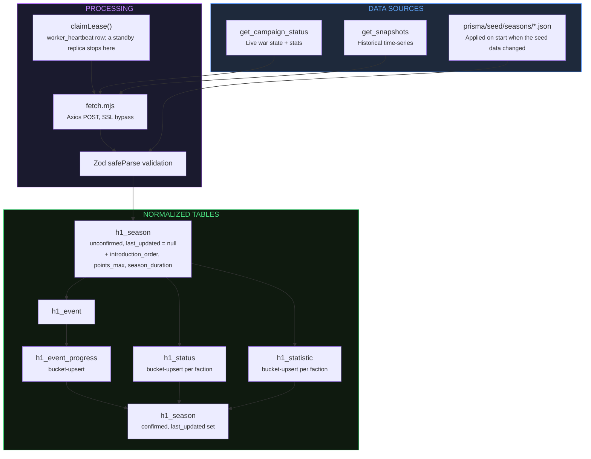
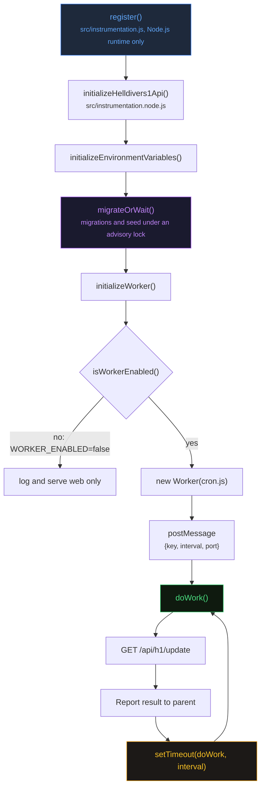

export const metadata = {
    title: 'Data Flow | Helldivers Bot',
    description:
        'Worker pipeline, poller lease, bucketed upserts, and data fetching architecture for helldivers.bot.',
    alternates: { canonical: '/docs/data-flow' },
    openGraph: { url: '/docs/data-flow' },
};

# Data Flow

Technical reference for how the helldivers.bot application fetches, validates, and persists data from the official Helldivers 1 API.

---

## 1. Overview

The full data pipeline from external API to stored records:



<details>
<summary>Text version of the pipeline</summary>

```
Official API (api.helldiversgame.com)
    |
    v
src/update/fetch.mjs          — HTTP layer (Axios POST, SSL bypass)
    |
    v
src/validators/               — Zod safeParse validation
    |
    v
h1_season (unconfirmed)       — Season record, last_updated = null
                                 + introduction_order, points_max, season_duration
    |
    v  [sequential]
h1_event                      — Unified defend/attack events
h1_event_progress             — Event progress (bucket-upsert)
h1_status                     — Per-faction campaign state (bucket-upsert)
h1_statistic                  — Per-faction statistics (bucket-upsert)
    |
    v
h1_season (confirmed)         — last_updated set only after all child writes succeed
```

</details>

There are two distinct pipelines that share this shape:

- **Status pipeline** (`updateStatus()`) — runs on every poll of the replica that holds the poller lease, and updates the current campaign state. Writes `h1_season` (with inlined metadata), `h1_event`, `h1_event_progress`, `h1_status`, and `h1_statistic`. All timeseries tables use a tumbling-window bucket-upsert pattern.
- **Season pipeline** (`updateSeason(season)`) — runs on every poll for the active season (with `protectedBucket`, so it never overwrites the bucket `updateStatus()` just wrote), once in the closing pass after a season change, and on demand when historical season data is needed. Writes `h1_season` (with inlined metadata), `h1_event`, and `h1_status`.

---

## 2. Worker Thread Lifecycle

Sources: `src/instrumentation.js`, `src/instrumentation.node.js`, `src/update/migrateOnStart.mjs`, `src/shared/utils/initializeWorker.mjs`, `public/workers/cron.js`, `public/workers/cronLogic.js`

### Startup



Next.js awaits `register()` before the server takes a request, so everything in the chain finishes first. `register()` only acts under the Node.js runtime (`NEXT_RUNTIME === 'nodejs'`). It calls `initializeHelldivers1Api()`, which runs three steps in order:

1. `initializeEnvironmentVariables()` checks the required variables. A missing core variable throws and stops the start.
2. `migrateOrWait()` applies pending Prisma migrations and, when the seed data changed, the seed. It holds a Postgres advisory lock, so replicas that start together migrate one at a time. It never throws: a failed attempt is logged, reported, and retried after 30 s, 60 s, 2 min, then every 5 min until it succeeds. The worker never starts before it finishes. It is skipped under Vitest and `NODE_ENV=test`.
3. `initializeWorker()` spawns the cron thread.

`initializeWorker()` guards against non-Node.js runtimes before doing anything:

```js
if (process.env.NEXT_RUNTIME === 'nodejs') { ... }
```

When `isWorkerEnabled()` is false (`WORKER_ENABLED` set to `false`, `0`, `no` or `off`), it logs that this instance serves web only and returns without a thread. Otherwise it needs `UPDATE_KEY` and `UPDATE_INTERVAL` and spawns the thread.

The worker script path is resolved differently depending on environment:

| Environment              | Resolved path                                           |
| ------------------------ | ------------------------------------------------------- |
| `development`            | `path.resolve(process.cwd(), 'public/workers/cron.js')` |
| `production` / `staging` | `path.resolve('/app/public/workers/cron.js')`           |

After spawning, the parent sends a single initialization message to the worker:

```js
worker.postMessage({ key: key, interval: interval, port: port });
```

### Poller lease

Every replica runs the cron thread, but only one replica polls the official API at a time. The coordination is one row in `worker_heartbeat` (`worker_type = 'cron_api_poller'`, see [Database Schema](/docs/database)).

- Each poll starts with `claimLease()` in `src/update/lease.mjs`: one atomic `INSERT ... ON CONFLICT DO UPDATE ... WHERE` on that row.
- The claim succeeds when this replica already holds the row, or when `lease_until` has passed. A successful claim renews `lease_until` by 60 s (`LEASE_TTL_S`).
- The holder does the work. Any other replica gets `200 { role: 'standby' }` straight away and touches nothing.
- A holder that stops renewing loses the lease after at most 60 s. The next replica to poll takes it over. There is no election and no manual step.
- `prev_events` (the push-notification baseline) and `last_season_observed` (for the closing pass) live in the same row. A new holder inherits them, so a handover neither misses nor repeats a transition.
- `persistPollerState()` writes them back only while the caller is still the holder, so a replica whose lease expired mid-poll cannot overwrite the new holder.
- A replica with `WORKER_ENABLED=false` never spawns the thread, and its update route answers 403.
- Replica topology: see [Infrastructure](/docs/infrastructure).

### Worker message loop

`cron.js` is a thin shell. It listens for exactly one message from the parent and, on receipt, starts the polling loop that `makeDoWork()` builds in `cronLogic.js`:

```js
parentPort.on('message', (msg) => {
    const doWork = makeDoWork(msg, parentPort);
    doWork();
});
```

`doWork()` calls the internal update route with an `Authorization: Bearer <key>` header. The very first poll of a worker also sends `X-Worker-Startup`:

```js
const url = `http://localhost:${port}/api/h1/update`;
const response = await fetch(url, {
    headers: {
        Authorization: `Bearer ${key}`,
        ...(isFirstPoll && { 'X-Worker-Startup': '1' }),
    },
});
```

The route declares the matching header name (`WORKER_STARTUP_HEADER` in `src/app/api/h1/update/route.js`) but does not act on it yet. After a 2xx answer, and only then, `doWork()` sends a fire-and-forget `POST` to `GLITCHTIP_HEARTBEAT_URL` when that variable is set, so a sustained 5xx turns the uptime monitor red.

After each attempt, success or failure, the worker reports back to the parent:

- Success: `{ data: responseJson, time: new Date().toString() }`
- Error: `{ error: err.toString(), time: new Date().toString() }`

Errors do not stop the worker. The loop continues unconditionally.

### Sequential scheduling with `setTimeout`

The worker uses `setTimeout(doWork, interval * 1000)` at the end of `doWork()`, not `setInterval`. This is intentional: the next poll only starts after the current one fully resolves. If an update takes longer than the configured interval, requests will not overlap and database operations will not race.

### Parent-side message handling

The parent logs errors from worker messages and thread-level errors. A worker exit outside a shutdown ends the process, so the orchestrator restarts the container. The container health check only pings the database, and a dead thread would otherwise leave a healthy task that never polls:

```js
worker.on('message', (data) => {
    if (data.error) console.error('Worker error:', data.error, 'at', data.time);
});
worker.on('error', (err) => console.error('Worker thread error:', err));
worker.on('exit', (code) => {
    console.info(`Worker stopped with exit code ${code}`);
    worker = null;
    if (!shuttingDown) process.exit(1);
});
```

### Graceful shutdown

On `SIGINT` or `SIGTERM`, the parent sets `shuttingDown`, terminates the worker, and then exits, so the exit handler above does not fire `process.exit(1)`:

```js
process.on('SIGINT', async () => {
    shuttingDown = true;
    if (worker) await worker.terminate();
    process.exit();
});
```

---

## 3. Status Update Pipeline

Source: `src/update/status.mjs` — `updateStatus()`

This function runs inside `GET /api/h1/update`, which the worker calls on every tick with an `Authorization: Bearer <key>` header. The route compares the key with a timing-safe check (401 on a mismatch) and answers 403 on a replica that opted out with `WORKER_ENABLED=false`. It then calls `claimLease()` and answers `200 { role: 'standby' }` early on a replica that does not hold the lease (see Poller lease in section 2). Only the holder reaches `updateStatus()`. The function fetches the current campaign state and persists it to the `h1_*` tables.

After `updateStatus()` the route runs the season closing pass when the season changed (see Season transition closing pass in section 4), then `updateSeason()` for the active season, reports the non-fatal warnings both pipelines returned, and starts the push-notification check after the response. It records the poll in the heartbeat row last.

### Step-by-step

**Step 1 — Fetch**

```js
const { data: fetchedData, error: fetchedError } = await tryCatch(fetchStatus());
```

`fetchStatus()` POSTs `action=get_campaign_status` to the official API and throws on network failure or an empty response. `tryCatch()` returns the error instead of throwing. If `fetchedError` is set, `updateStatus()` throws immediately with a descriptive message and a `cause` pointing to the source location.

**Step 2 — Zod validation**

```js
const check = isValidStatus.safeParse(fetchedData);
if (!check.success) throw new Error(...);
```

`isValidStatus` runs a Zod `safeParse` against the response. It validates the shape of `campaign_status[]`, `defend_event`, `attack_events[]`, and `statistics[]`. Validation failure throws before any database write occurs.

**Step 3 — Resolve the season**

```js
const season = getSeasonFromStatus(fetchedData);
```

`getSeasonFromStatus` reads the season number from `campaign_status` and `statistics`. It logs a warning if more than one season value is present across those fields. The `defend_event` and `attack_events` slots are deliberately excluded because they can belong to a prior season while the rest of the payload belongs to the current one.

**Step 4 — Create the unconfirmed season record with inlined metadata**

```js
await tryCatch(upsertSeason(season, false, { introOrder, pointsMax, seasonDuration }));
```

A row for this season is created in `h1_season` with `last_updated` left as `null` and the season-level metadata (`introduction_order`, `points_max`, `season_duration`) inlined directly on the row. The `false` parameter signals that this is the initial, unconfirmed creation. See the Confirm Pattern section below.

**Step 5 — Upsert events**

```js
// Defend event (guard for null — API omits when no defend active)
if (fetchedData.defend_event) {
    await tryCatch(upsertEvent(season, EVENT_TYPE.DEFEND, fetchedData.defend_event));
}

// Attack events
for (const event of fetchedData.attack_events) {
    await tryCatch(upsertEvent(season, EVENT_TYPE.ATTACK, { ...event, region: 11 }));
}
```

Both defend and attack events are written through the unified `upsertEvent(season, type, event)` function to the `h1_event` table. Key differences:

- `defend_event` is a single nullable object in the API response. It is guarded with an `if` check — the API omits this field when no defend event is active.
- `attack_events` is an array. Each event is spread with `region: 11` added, because attack events always target the enemy homeworld (region 11) and the API does not include the region field.

`upsertEvent` skips an event whose own `season` differs from the active season. After a season change the API keeps the old season's events in these slots for a few minutes, and the skip stops them from leaking into the new season. Events are written sequentially, not in parallel. A write error throws immediately.

**Step 6 — Upsert h1_status (per-faction campaign state, bucket-upsert)**

```js
for (let enemy = 0; enemy < 3; enemy++) {
    const campaign = fetchedData.campaign_status[enemy];
    await tryCatch(upsertStatus(season, enemy, fetchedData.time, campaign));
}
```

The pipeline loops over the three enemy factions (0, 1, 2). For each faction, it upserts a row in `h1_status` containing the campaign data (points, points_taken, status), keyed on `season + enemy + bucket`. Map state is not stored in the database — `computeMapState` rebuilds it at request time from `h1_status` and `h1_event` data.

**Step 7 — Upsert h1_statistic (per-faction statistics, bucket-upsert)**

```js
for (let enemy = 0; enemy < 3; enemy++) {
    const stats = fetchedData.statistics[enemy];
    await tryCatch(upsertStatistic(season, enemy, fetchedData.time, stats));
}
```

For each faction, the pipeline upserts a row in `h1_statistic` with the per-faction statistics fields. Same bucket-upsert pattern. A write error throws.

**Step 8 — Event progress (bucket-upsert)**

```js
// For the defend event and every attack event:
await tryCatch(upsertEventProgress(season, type, event, fetchedData.time));
```

For the defend event and each attack event, `upsertEventProgress()` records the event's `points` at the poll's bucket. Within the same bucket window, the existing row is updated with the latest value. At a bucket boundary, a new row is inserted. It skips an event that belongs to another season.

This is the one non-fatal step. A failure is pushed to a `warnings` array and the pipeline carries on.

**Step 9 — Confirm season**

```js
await tryCatch(upsertSeason(season, true));
```

`last_updated` is set only now, after all child writes have succeeded. See the Confirm Pattern section below.

**Return value**

```js
return { ms, season, time, confirmSeason, warnings };
```

`ms` is the execution time in milliseconds, `time` is the API's poll time, `confirmSeason` is the updated `h1_season` record, and `warnings` holds the non-fatal failures from step 8. The route logs each warning and reports it to the error tracker at warning level.

### Confirm pattern

`upsertSeason` is called twice in every pipeline run:

| Call                           | Parameter | Effect                                                             |
| ------------------------------ | --------- | ------------------------------------------------------------------ |
| `upsertSeason(season, false)`  | `false`   | Creates or touches the season row; leaves `last_updated` as `null` |
| `upsertSeason(season, true)`   | `true`    | Sets `last_updated` to the current timestamp                       |

The invariant this enforces: a season row with `last_updated !== null` has a complete, consistent set of child records. Any season row where `last_updated` is `null` was either just created and is mid-pipeline, or a previous pipeline run failed partway through. Consumers of the `h1_*` tables can filter on `last_updated IS NOT NULL` to read only confirmed seasons.

### Error handling

Every async operation is wrapped in `tryCatch()`, which returns `{ data, error }` instead of throwing. Errors surface as explicit `if (someError) throw new Error(...)` checks after each step, with a `cause` field that identifies the exact source file and operation where the code sets one. This makes stack traces actionable without relying on implicit propagation.

The exception is event progress (Step 8), which collects failures into `warnings` instead of throwing. The pipeline completes and confirms the season even if an individual event-progress write fails.

---

## 4. Season Snapshot Pipeline

Source: `src/update/season.mjs` — `updateSeason(season, opts)`

This function fetches the full historical snapshot data for a given season number. It is structurally similar to the status pipeline but operates on different data: it writes `h1_season`, `h1_event` and `h1_status` only, and it does not write `h1_event_progress` or `h1_statistic`. The optional `opts.protectedBucket` makes it skip snapshot frames in or after that bucket.

### Step-by-step

**Step 0 — Guard and timing**

```js
if (!season) throw new Error('season is missing');
const start = performance.now();
```

Season is required. If absent, the function throws before attempting any I/O.

**Step 1 — Fetch**

```js
const { data: fetchedData, error: fetchedError } = await tryCatch(fetchSeason(season));
```

`fetchSeason` validates the season parameter with `isValidNumber.safeParse`, then POSTs `action=get_snapshots` with `season=N`. A failed season fetch is always a hard failure: `updateSeason` throws with a `cause` that names the call.

**Step 2 — Zod validation**

```js
const check = isValidSeason.safeParse(fetchedData);
```

Validates the snapshot response shape. On failure, the individual Zod issues are logged before throwing.

**Step 3 — Cross-check season**

```js
const fetchedSeason = getSeasonFromSnapshot(fetchedData);
if (season !== fetchedSeason) throw new Error('Invalid season');
```

The season number embedded in the response payload is compared against the requested season. A mismatch throws immediately, preventing data from being stored under the wrong season key. If the response holds no snapshots and no events at all, the season does not exist on the official API. `updateSeason` then throws `Season N not found` with `cause = SEASON_NOT_FOUND`, which the API routes turn into a 404.

**Step 4 — Create the unconfirmed season record with inlined metadata**

```js
await tryCatch(
    upsertSeason(season, false, {
        introOrder: fetchedData.introduction_order,
        pointsMax: fetchedData.points_max,
    }),
);
```

Same confirm pattern as the status pipeline. The per-faction metadata is inlined directly on the `h1_season` row. `season_duration` comes only from the status pipeline.

**Step 5 — Upsert h1_status from snapshots**

```js
for (const snap of fetchedData.snapshots) {
    if (protectedBucket !== undefined && computeBucket(snap.time) >= protectedBucket)
        continue;
    for (let enemy = 0; enemy < 3; enemy++) {
        await tryCatch(upsertStatus(season, enemy, snap.time, parsed[enemy]));
    }
}
```

Each historical snapshot frame carries a stringified JSON array indexed by faction. It is parsed and each faction's campaign data is upserted into `h1_status` with the same bucket-upsert pattern as the status pipeline. This populates the campaign timeseries from archived data. The worker poll passes `protectedBucket`, so stale frames never overwrite the bucket that `updateStatus()` just wrote. A failed frame write is added to `warnings` and the loop continues.

**Step 6 — Upsert defend and attack events**

```js
for (const event of fetchedData.defend_events) {
    await tryCatch(upsertEvent(season, EVENT_TYPE.DEFEND, event));
}
for (const event of fetchedData.attack_events) {
    await tryCatch(upsertEvent(season, EVENT_TYPE.ATTACK, { ...event, region: 11 }));
}
```

Events are iterated individually and each is written to `h1_event` via the unified `upsertEvent` function. In the season pipeline, `defend_events` is an array (plural) because snapshot data contains full historical event lists rather than a single current event. Attack events are spread with `region: 11` added, same as in the status pipeline. A write error throws.

**Step 7 — Confirm season**

```js
await tryCatch(upsertSeason(season, true));
```

**Return value**

```js
return { ms, season, time, confirmSeason, warnings };
```

### Where `updateSeason` runs

`updateSeason()` runs on a schedule and on demand:

- **Every poll.** `GET /api/h1/update` calls `updateSeason(statusData.season, { protectedBucket })` after `updateStatus()`, with `protectedBucket = computeBucket(statusData.time)`.
- **The closing pass.** The same route calls `updateSeason(lastSeasonObserved)` once when the season increases (see below).
- **On demand.** The callers below run it when a season is missing from the local database or an admin asks for a refresh.

### On-demand invocation

These callers invoke `updateSeason()` reactively:

- `getCampaignOrSeed(season)` — reads `h1_*` first and calls `updateSeason(season)` on a miss. The `/archives` page and `GET /api/h1/campaign?season=N` both use it.
- `POST /api/h1/rebroadcast` with `action=get_snapshots` — reconstructs the response from `h1_*` tables; calls `updateSeason(season)` if the season data is absent.
- `backfillAndRetry()` in `src/shared/utils/api/backfillSeason.mjs` — calls `backfillSeason()`, which calls `updateSeason(season)`. The four `/api/v1/h1/*` routes (`status`, `map`, `season`, `stats`) use it, after a rate-limit check, when a read finds no data for a past season. The `current` season is never backfilled.
- `reseedSeason(season)` in `src/features/archives/reseedSeason.mjs` — the admin Refresh button on `/archives`. When the season is the latest one it passes `protectedBucket`.

After `updateSeason()` returns, the handler re-queries the database and returns the result. This means a cold request for an unknown season incurs one extra round-trip to the official API before responding.

### Frontend on-demand fetching

The `/archives` history page also fetches seasons on demand, through `getCampaignOrSeed()` and the same shared pipeline the worker uses. When a user selects a season not yet in the database:

1. `getCampaign(season)` returns `null`
2. `updateSeason(season)` calls `fetchSeason(season)` (official API) and upserts into `h1_season` (with inlined metadata), `h1_event`, and `h1_status`
3. `getCampaign(season)` is re-queried and now returns the seeded data

The season selector on `/archives` is derived from the current season number (`Array.from({length: activeSeason - 1}, ...)`), not from a database query. This ensures all past seasons are always selectable regardless of what exists in the DB.

### Season transition closing pass

When the HD1 API transitions from one season to the next, it writes one final "closing" snapshot to the old season's history a few minutes after the transition point. The route reads the season observed on the previous poll from the lease row (`lastSeasonObserved`) when it claims the lease. If the current season is higher, the route runs `updateSeason(lastSeasonObserved)` once, right after `updateStatus()`, to capture the closing snapshot that would otherwise be missed as the worker's focus moves to the new season. Then it writes the new season number back with `persistPollerState()`.

The closing pass is non-fatal on error (the current season's update is more critical): the failure is logged and reported at warning level. It is scoped to the single transition event; it does not re-run on subsequent polls. Because the value lives in the lease row, it survives restarts and handovers between replicas. A closing snapshot that still fails can be recovered with the admin refresh button on `/archives?season=N`.

---

## 5. Table Strategy

All data is stored in normalized relational tables using the `h1_*` prefix. There are five tables total. A sixth table, `worker_heartbeat`, holds the poller lease (see Poller lease in section 2); it is not part of the war record.

### H1 tables

| Table               | Relationship                                | Written by           |
| ------------------- | ------------------------------------------- | -------------------- |
| `h1_season`         | Root; one row per season (+ inlined arrays) | Both pipelines       |
| `h1_event`          | Many per season (defend + attack unified)   | Both pipelines       |
| `h1_event_progress` | Many per event (bucket-upsert)              | Status pipeline only |
| `h1_status`         | Many per season (bucket-upsert per faction) | Both pipelines       |
| `h1_statistic`      | Many per season (bucket-upsert per faction) | Status pipeline only |

These tables store normalized, relational data keyed on `season`. They accumulate historical records across every update cycle, enabling structured queries, aggregations, and time-series analysis. They are used by the `/api/h1/campaign` endpoint, the `/api/h1/rebroadcast` endpoint (which reconstructs the official API format on demand), the `/api/v1/h1/*` endpoints, and the frontend.

### Bucket-upsert pattern

All timeseries tables (`h1_status`, `h1_statistic`, `h1_event_progress`) use a tumbling-window bucket-upsert pattern. Each poll computes `bucket = floor(poll_time / BUCKET_SIZE) * BUCKET_SIZE` via `computeBucket()` from `src/shared/utils/bucketing.mjs`. Within an active bucket window, subsequent polls UPDATE the existing row. At a bucket boundary, a new row is INSERTed. `BUCKET_SIZE` is configurable via env var (default 900 = 15 min). The bucket math is deterministic and keeps no state in memory.

---

## 6. Bucketing System

Source: `src/shared/utils/bucketing.mjs`

The status pipeline runs on every poll of the lease holder (every `UPDATE_INTERVAL` seconds), but writing a new row on every poll would generate excessive data. The bucketing system controls write granularity using deterministic bucket math — no in-memory state or database cold-start queries needed.

### How it works

```js
const DEFAULT_BUCKET_SIZE = 900;
const parsed = parseInt(process.env.BUCKET_SIZE ?? '', 10);
export const BUCKET_SIZE =
    Number.isFinite(parsed) && parsed > 0 ? parsed : DEFAULT_BUCKET_SIZE; // 15 min default

export function computeBucket(pollTime) {
    return Math.floor(pollTime / BUCKET_SIZE) * BUCKET_SIZE;
}
```

Each query function (`upsertStatus`, `upsertStatistic`, `upsertEventProgress`) calls `computeBucket(time)` and uses the result as part of the unique constraint key. Prisma's `upsert` handles the rest:

- **Within a bucket window:** the existing row is UPDATEd with latest values.
- **At a bucket boundary:** a new row is INSERTed.

### Configuration

| Setting       | Default | Env var       | Notes                                                                  |
| ------------- | ------- | ------------- | ---------------------------------------------------------------------- |
| `BUCKET_SIZE` | `900`   | `BUCKET_SIZE` | Seconds per bucket window. Parsed once at module load; invalid or non-positive values fall back to 900. |

### Properties

- **Stateless:** No in-memory state to lose on restart or on a handover between replicas. No cold-start database queries.
- **Deterministic:** The same `(entity, time)` input always maps to the same bucket. No race conditions.
- **Idempotent:** Re-processing the same data (e.g., during backfill) safely upserts into existing rows.

---

## 7. Fetching Layer

Source: `src/update/fetch.mjs`

### Request target

Every environment (`development`, `staging`, `production`) uses the same constant:

```js
const HD1_API_URL = 'https://api.helldiversgame.com/1.0/';
```

There is no per-environment switch.

### `fetchWithUntrustedCert(url, formData)`

The internal HTTP function used by both public fetchers. It is not exported. It creates an `https.Agent` with SSL certificate validation disabled:

```js
const agent = new https.Agent({ rejectUnauthorized: false });
```

This is required because the official Helldivers 1 API has certificate issues that would otherwise cause every request to fail. The agent is passed to Axios on every call.

The function uses `axios.post`. It throws in three cases:

- Axios throws an `AxiosError` (network failure, non-2xx status, etc.) — the error is wrapped with the HTTP status and message included.
- Axios throws anything else — the error is replaced by `Failed to fetch data from axios`.
- The response has no `data` field.

### `fetchStatus()`

```js
export async function fetchStatus() { ... }
```

Posts `action=get_campaign_status`. Delegates directly to `fetchWithUntrustedCert` and returns the result. On error, the exception propagates to the caller (`updateStatus`) which handles it via `tryCatch`.

### `fetchSeason(season)`

```js
export async function fetchSeason(season) { ... }
```

Validates `season` with `isValidNumber.safeParse` before constructing the request. Posts `action=get_snapshots` with `season=N`. On validation failure, throws `Invalid season` before making any network request. On network error, the exception propagates from `fetchWithUntrustedCert`.

---

## Cross-references

- See [Database Schema](/docs/database) for table structures and column definitions.
- See [Notifications](/docs/notifications) for the live data polling, toast notifications, and push notification systems that consume the update pipeline's output. The frontend polls `GET /api/h1/live` every 10 seconds via the `useLiveData` hook.
- See [API Reference](/docs/api) for the `/api/h1/update` endpoint that triggers the status pipeline on each poll of the lease holder, and `/api/h1/live` for the polling endpoint that serves live data to clients.
- See [Utilities](/docs/utilities) for `tryCatch`, `getSeasonFromStatus`, `getSeasonFromSnapshot`, and the Zod validation schemas.
