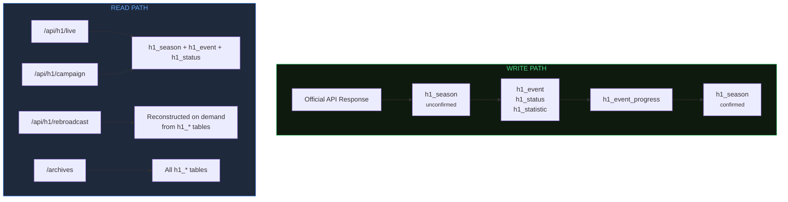

export const metadata = {
    title: 'Database Schema | Helldivers Bot',
    description:
        'Prisma 7 schema reference — models, relationships, indexes, and constraints for helldivers.bot.',
    alternates: { canonical: '/docs/database' },
    openGraph: { url: '/docs/database' },
};

# Database Schema

This document is the canonical reference for the PostgreSQL schema managed by Prisma. It covers every model, field, constraint, and index. Cross-references to data flow and API behaviour are noted inline.

---

## 1. Schema Configuration

Prisma 7 separates schema definition from connection configuration. The schema file (`prisma/schema.prisma`) defines the provider and generator. The connection URL lives in `prisma.config.mjs`.

### Schema file

```prisma
datasource db {
    provider = "postgresql"
}

generator client {
    provider = "prisma-client"
    output   = "../src/generated/prisma"
}
```

| Setting       | Value                     | Notes                                                            |
| ------------- | ------------------------- | ---------------------------------------------------------------- |
| Provider      | `postgresql`              | Connection URL configured externally in `prisma.config.mjs`      |
| Generator     | `prisma-client`           | Prisma 7 standard generator (replaces legacy `prisma-client-js`) |
| Client output | `../src/generated/prisma` | Import path: `@/generated/prisma/client`                         |

### Connection configuration (`prisma.config.mjs`)

```js
import dotenv from 'dotenv';
dotenv.config({ path: '.env.development' });
dotenv.config(); // fallback to .env (production/Docker)
import { defineConfig, env } from 'prisma/config';

export default defineConfig({
    schema: 'prisma/schema.prisma',
    migrations: { path: 'prisma/migrations' },
    datasource: { url: env('POSTGRES_URL') },
});
```

This file is read by the Prisma CLI for migrations and introspection. The CLI loads `.env.development` first, then falls back to `.env`. In Docker, `POSTGRES_URL` comes from the environment.

### Runtime client (`src/db/db.js`)

Prisma 7 requires a JavaScript driver adapter instead of the Rust query engine. The project uses `@prisma/adapter-pg` (which bundles `pg` internally):

```js
import { PrismaClient } from '@/generated/prisma/client';
import { PrismaPg } from '@prisma/adapter-pg';

const getConnectionString = () => {
    if (!process.env.POSTGRES_URL) {
        throw new Error('POSTGRES_URL is not set');
    }

    return process.env.POSTGRES_URL;
};

const prismaClientSingleton = () => {
    const adapter = new PrismaPg({ connectionString: getConnectionString() });
    return new PrismaClient({ adapter });
};
```

The singleton pattern caches the client on `globalThis.prismaGlobal` to survive Next.js hot reloads in development.

### Timestamp type

Every `DateTime` field maps to PostgreSQL `TIMESTAMP(3)`, a timestamp without a time zone (millisecond precision). The app writes and reads UTC, so the stored values are naive UTC. Raw SQL that compares with a column must use `now() AT TIME ZONE 'UTC'`, not a bare `now()` (see `src/update/lease.mjs`).

---

## 2. Entity Relationship Diagram

```mermaid
erDiagram
    h1_season ||--o{ h1_status : "OneSeasonToManyStatus"
    h1_season ||--o{ h1_statistic : "OneSeasonToManyStatistic"
    h1_season ||--o{ h1_event : "OneSeasonToManyEvents"
    h1_event ||--o{ h1_event_progress : "OneEventToManyProgress"

    h1_season {
        String   id                 PK
        DateTime last_updated       "nullable"
        Int      season             UK
        Int[]    introduction_order
        Int[]    points_max
        Int      season_duration
    }

    h1_event {
        String id       PK
        Int    season   FK
        String type
        Int    event_id
        Int    region
        String status
    }

    h1_status {
        String id     PK
        Int    season FK
        Int    enemy
        Int    bucket
        Int    time
        Int    points
        String status
    }

    h1_statistic {
        String id     PK
        Int    season FK
        Int    enemy
        Int    bucket
        Int    time
        BigInt kills
        BigInt deaths
    }

    h1_event_progress {
        String id       PK
        String type
        Int    event_id FK
        Int    bucket
        Int    time
        Int    points
    }

    User ||--o{ Account : "accounts"
    User ||--o{ Session : "sessions"
    User ||--o| Settings : "settings"
    User ||--o{ ApiKey : "apiKeys"

    User {
        String   id            PK
        String   username      UK
        String   email         UK
        Boolean  emailVerified
        String   role
        Boolean  banned
        DateTime createdAt
        DateTime updatedAt
    }

    Account {
        String   id         PK
        String   userId     FK
        String   accountId
        String   providerId
        DateTime accessTokenExpiresAt
        DateTime refreshTokenExpiresAt
    }

    Session {
        String   id        PK
        String   token     UK
        String   userId    FK
        DateTime expiresAt
        String   ipAddress
        String   userAgent
    }

    Verification {
        String   id         PK
        String   identifier
        String   value
        DateTime expiresAt
    }

    Settings {
        String userId PK, FK
        Json   settings
    }

    ApiKey {
        String  id      PK
        String  hash    UK
        String  userId  FK
        Boolean enabled
        DateTime lastUsedAt "nullable"
    }

    worker_heartbeat {
        String   worker_type          PK
        DateTime last_beat
        Int      poll_duration_ms     "nullable"
        String   last_error           "nullable"
        DateTime started_at
        DateTime updated_at
        String   holder_id            "nullable"
        DateTime lease_until          "nullable"
        Json     prev_events          "nullable"
        Int      last_season_observed "nullable"
    }

    app_instance {
        String   id             PK "HOLDER_ID"
        String   host
        String   version
        Boolean  worker_enabled
        DateTime started_at
        DateTime last_seen
    }

    seed_state {
        Int      id         PK "always 1"
        String   hash
        DateTime applied_at
    }

    push_subscription {
        Int      id         PK "autoincrement"
        String   endpoint   UK
        String   keys_p256dh
        String   keys_auth
        DateTime created_at
    }

    api_rate_limit {
        String key          PK
        String route_group  PK
        Int    window_start PK
        Int    count
    }
```



> The former `rebroadcast_status` and `rebroadcast_snapshot` tables have been removed. The `/api/h1/rebroadcast` endpoint now reconstructs the raw API response format on demand from the normalized `h1_*` tables.

### Data Lifecycle



---

## 3. Game Data Models

### h1_season

The root anchor for all game data. Every normalised game table points back to this row via `season` (the integer game season number, not the surrogate `id`). Season-level metadata (`introduction_order`, `points_max`, `season_duration`) is inlined directly on this model rather than stored in separate tables.

| Field                | Prisma Type | PostgreSQL Type | Constraints / Notes                                                                                                                                                           |
| -------------------- | ----------- | --------------- | ----------------------------------------------------------------------------------------------------------------------------------------------------------------------------- |
| `id`                 | `String`    | `TEXT`          | `@id @default(uuid(7))` — surrogate PK, UUIDv7                                                                                                                                |
| `last_updated`       | `DateTime?` | `TIMESTAMP(3)` | Nullable. `null` means the season row was pre-seeded but has not yet received a successful data update. Set to the current timestamp at the end of a successful update cycle. |
| `season`             | `Int`       | `INTEGER`       | `@unique` — the game season number. Used as the FK target by all child tables.                                                                                                |
| `introduction_order` | `Int[]`     | `INTEGER[]`     | `@default([])` — faction reveal order, indexed by faction (enemy 0, 1, 2). The **value** is a 0-based rank: `0` = the faction the war started against, `1`/`2` = mid-war arrivals, `255` = never introduced. |
| `points_max`         | `Int[]`     | `INTEGER[]`     | `@default([])` — maximum liberation points per faction. Indexed by faction (enemy 0, 1, 2).                                                                                   |
| `season_duration`    | `Int`       | `INTEGER`       | `@default(0)` — total duration of the season in seconds.                                                                                                                      |

**Indexes:**

| Index                     | Fields       |
| ------------------------- | ------------ |
| `@@index([season])`       | season       |
| `@@index([last_updated])` | last_updated |

**Relations (outbound):**

| Relation name              | Target model   | Cardinality |
| -------------------------- | -------------- | ----------- |
| `OneSeasonToManyStatus`    | `h1_status`    | one-to-many |
| `OneSeasonToManyStatistic` | `h1_statistic` | one-to-many |
| `OneSeasonToManyEvents`    | `h1_event`     | one-to-many |

**Design note:** Child tables reference `season` (Int) rather than the surrogate `id` (UUID). This keeps foreign keys human-readable, avoids UUID joins in queries that filter by season number, and matches the season integer used in the official API response.

---

### h1_event

A unified table that holds both attack and defend events in a single model. The `type` column discriminates between the two event kinds, eliminating the need for UNION queries across separate tables.

| Field              | Prisma Type | PostgreSQL Type | Constraints / Notes                                                                                                       |
| ------------------ | ----------- | --------------- | ------------------------------------------------------------------------------------------------------------------------- |
| `id`               | `String`    | `TEXT`          | `@id @default(uuid(7))`                                                                                                   |
| `season`           | `Int`       | `INTEGER`       | FK → `h1_season.season`                                                                                                   |
| `type`             | `String`    | `TEXT`          | `"attack"` or `"defend"` — discriminator column                                                                           |
| `event_id`         | `Int`       | `INTEGER`       | Official API event identifier                                                                                             |
| `start_time`       | `Int`       | `INTEGER`       | Unix timestamp                                                                                                            |
| `end_time`         | `Int`       | `INTEGER`       | Unix timestamp                                                                                                            |
| `region`           | `Int`       | `INTEGER`       | Actual region integer for defend events. Sentinel value `11` for attack events (attack events have no region in the API). |
| `enemy`            | `Int`       | `INTEGER`       | Enemy faction identifier                                                                                                  |
| `points_max`       | `Int`       | `INTEGER`       |                                                                                                                           |
| `points`           | `Int`       | `INTEGER`       |                                                                                                                           |
| `status`           | `String`    | `TEXT`          | `"active"`, `"success"`, or `"fail"`                                                                                      |
| `players_at_start` | `Int?`      | `INTEGER`       | Nullable. Player count when the event started. May be unavailable for older events.                                       |

**Constraints and indexes:**

| Type       | Fields             | Notes                                                              |
| ---------- | ------------------ | ------------------------------------------------------------------ |
| `@@unique` | `[type, event_id]` | Compound unique — event IDs are unique within a type               |
| `@@index`  | `[season, type]`   | Filter events by type within a season                              |
| `@@index`  | `[season, status]` | Filter events by status within a season (e.g., active events only) |
| `@@index`  | `[season, enemy]`  | Filter events by enemy faction within a season                     |

**Relations:**

| Relation name            | Target model        | Cardinality |
| ------------------------ | ------------------- | ----------- |
| `OneSeasonToManyEvents`  | `h1_season`         | many-to-one |
| `OneEventToManyProgress` | `h1_event_progress` | one-to-many |

---

### h1_event_progress

Bucketed time-series data for individual events. Each row captures the `points` of an event within a time bucket, enabling progress-over-time visualisations. Links to `h1_event` via the compound `(type, event_id)` key. Uses the same tumbling-window bucket-upsert pattern as `h1_status` and `h1_statistic` — `points_max` is constant per event and lives on `h1_event`, so only `points` (the progression signal) is tracked here.

| Field      | Prisma Type | PostgreSQL Type | Constraints / Notes                                                    |
| ---------- | ----------- | --------------- | ---------------------------------------------------------------------- |
| `id`       | `String`    | `TEXT`          | `@id @default(uuid(7))`                                                |
| `type`     | `String`    | `TEXT`          | `"attack"` or `"defend"` — part of FK to `h1_event`                    |
| `event_id` | `Int`       | `INTEGER`       | Part of FK to `h1_event` via `(type, event_id)`                        |
| `bucket`   | `Int`       | `INTEGER`       | `floor(poll_time / BUCKET_SIZE) * BUCKET_SIZE` — tumbling window start |
| `time`     | `Int`       | `INTEGER`       | Latest poll time within this bucket (drifts with each upsert)          |
| `points`   | `Int`       | `INTEGER`       | Event progress at this timestamp                                       |

**Constraints and indexes:**

| Type       | Fields                     | Notes                               |
| ---------- | -------------------------- | ----------------------------------- |
| `@@unique` | `[type, event_id, bucket]` | One row per event per bucket window |

**Relations:**

| Relation name            | Target model | Cardinality |
| ------------------------ | ------------ | ----------- |
| `OneEventToManyProgress` | `h1_event`   | many-to-one |

---

### h1_status

Bucketed campaign timeseries. Each row captures the campaign state for one enemy faction within a time bucket. Uses a tumbling-window bucket-upsert pattern: `bucket = floor(poll_time / BUCKET_SIZE) * BUCKET_SIZE`. Within an active bucket window, subsequent polls UPDATE the existing row with latest values. At a bucket boundary, a new row is INSERTed. `BUCKET_SIZE` is configurable via env var (default 900 = 15 min).

| Field          | Prisma Type | PostgreSQL Type | Constraints / Notes                                                   |
| -------------- | ----------- | --------------- | --------------------------------------------------------------------- |
| `id`           | `String`    | `TEXT`          | `@id @default(uuid(7))`                                               |
| `season`       | `Int`       | `INTEGER`       | FK → `h1_season.season`                                               |
| `enemy`        | `Int`       | `INTEGER`       | Enemy faction identifier: `0` = Bugs, `1` = Cyborgs, `2` = Illuminate |
| `bucket`       | `Int`       | `INTEGER`       | `floor(poll_time / BUCKET_SIZE) * BUCKET_SIZE` — unique window start  |
| `time`         | `Int`       | `INTEGER`       | Latest poll time within this bucket (drifts with each upsert)         |
| `points`       | `Int`       | `INTEGER`       | Current liberation points                                             |
| `points_taken` | `Int`       | `INTEGER`       | Points taken by the enemy                                             |
| `status`       | `String`    | `TEXT`          | Enum-like: `"active"`, `"defeated"`, `"hidden"`                       |

**Constraints and indexes:**

| Type       | Fields                    | Notes                                            |
| ---------- | ------------------------- | ------------------------------------------------ |
| `@@unique` | `[season, enemy, bucket]` | One row per faction per bucket window per season |
| `@@index`  | `[season, bucket]`        | Range queries by season and time window          |

---

### h1_statistic

Bucketed per-faction statistics timeseries. Each row captures 11 statistical fields for one enemy faction within a time bucket. Uses the same tumbling-window bucket-upsert pattern as `h1_status`. Fields that are per-season state (like `season_duration`) or derivable from other tables (like event counts) have been moved out.

| Field                      | Prisma Type | PostgreSQL Type | Constraints / Notes                                                   |
| -------------------------- | ----------- | --------------- | --------------------------------------------------------------------- |
| `id`                       | `String`    | `TEXT`          | `@id @default(uuid(7))`                                               |
| `season`                   | `Int`       | `INTEGER`       | FK → `h1_season.season`                                               |
| `enemy`                    | `Int`       | `INTEGER`       | Enemy faction identifier: `0` = Bugs, `1` = Cyborgs, `2` = Illuminate |
| `bucket`                   | `Int`       | `INTEGER`       | `floor(poll_time / BUCKET_SIZE) * BUCKET_SIZE` — unique window start  |
| `time`                     | `Int`       | `INTEGER`       | Latest poll time within this bucket (drifts with each upsert)         |
| `players`                  | `Int`       | `INTEGER`       | `@default(0)` — active players during measurement window              |
| `total_unique_players`     | `Int`       | `INTEGER`       | `@default(0)` — unique players across the season                      |
| `missions`                 | `Int`       | `INTEGER`       | `@default(0)` — total missions attempted                              |
| `successful_missions`      | `Int`       | `INTEGER`       | `@default(0)`                                                         |
| `total_mission_difficulty` | `Int`       | `INTEGER`       | `@default(0)` — sum of difficulty values across all missions          |
| `completed_planets`        | `Int`       | `INTEGER`       | `@default(0)`                                                         |
| `kills`                    | `BigInt`    | `BIGINT`        | `@default(0)` — cumulative enemy kills                                |
| `deaths`                   | `BigInt`    | `BIGINT`        | `@default(0)` — cumulative player deaths                              |
| `accidentals`              | `BigInt`    | `BIGINT`        | `@default(0)` — cumulative friendly-fire deaths                       |
| `shots`                    | `BigInt`    | `BIGINT`        | `@default(0)` — cumulative shots fired                                |
| `hits`                     | `BigInt`    | `BIGINT`        | `@default(0)` — cumulative shots that connected                       |

**Constraints and indexes:**

| Type       | Fields                    | Notes                                            |
| ---------- | ------------------------- | ------------------------------------------------ |
| `@@unique` | `[season, enemy, bucket]` | One row per faction per bucket window per season |
| `@@index`  | `[season, bucket]`        | Range queries by season and time window          |

> **BigInt fields:** `kills`, `deaths`, `accidentals`, `shots`, and `hits` use `BigInt` (PostgreSQL `BIGINT`) rather than `Int`. Helldivers cumulative counts for an active season easily exceed the 32-bit integer maximum of ~2.1 billion. When reading these values in JavaScript, Prisma returns them as native `BigInt` primitives — serialisation to JSON requires explicit conversion (e.g., `.toString()` or a custom serialiser).

---

## 4. Rebroadcast (Removed)

The former `rebroadcast_status` and `rebroadcast_snapshot` tables have been dropped. They previously cached the raw, unmodified JSON responses from the official Helldivers API as a fast-path for the `/api/h1/rebroadcast` endpoint.

The rebroadcast endpoint now reconstructs the official API response format on demand from the normalized `h1_*` tables. This eliminates the storage duplication and the need to keep raw JSON in sync with normalised data.

---

## 5. Auth and User Models

These models implement [BetterAuth](https://www.better-auth.com/) with the Prisma adapter, plus application-specific extensions. Authentication is OAuth-only (Discord and GitHub providers). See [Authentication](/docs/authentication) for architecture details.

### User

Central user record. Extended beyond the BetterAuth baseline with `username`, `role`, `banned`, and application-specific relations.

| Field           | Prisma Type | PostgreSQL Type | Constraints / Notes                                                    |
| --------------- | ----------- | --------------- | ---------------------------------------------------------------------- |
| `id`            | `String`    | `TEXT`          | `@id @default(uuid(7))`                                                |
| `name`          | `String?`   | `TEXT`          | Display name, optional                                                 |
| `username`      | `String?`   | `TEXT`          | `@unique` — intended to hold the user's Discord username               |
| `email`         | `String?`   | `TEXT`          | `@unique`                                                              |
| `emailVerified` | `Boolean`   | `BOOLEAN`       | `@default(false)` — whether the user's email is confirmed              |
| `image`         | `String?`   | `TEXT`          | Avatar URL from OAuth provider or Gravatar fallback                    |
| `role`          | `String`    | `TEXT`          | `@default("user")` — application role string, not an enum              |
| `banned`        | `Boolean`   | `BOOLEAN`       | `@default(false)` — banned users have sessions revoked on next request |
| `createdAt`     | `DateTime`  | `TIMESTAMP(3)` | `@default(now())`                                                      |
| `updatedAt`     | `DateTime`  | `TIMESTAMP(3)` | `@updatedAt`                                                           |

**Relations:**

| Field      | Type        | Notes                           |
| ---------- | ----------- | ------------------------------- |
| `accounts` | `Account[]` | OAuth provider accounts         |
| `sessions` | `Session[]` | Active sessions                 |
| `settings` | `Settings?` | One-to-one application settings |
| `apiKeys`  | `ApiKey[]`  | API access keys                 |

---

### Account

BetterAuth OAuth account record. Links a user to an OAuth provider. Multiple providers per user are supported (e.g., both Discord and GitHub linked to one account).

| Field                   | Prisma Type | PostgreSQL Type | Constraints / Notes                                                       |
| ----------------------- | ----------- | --------------- | ------------------------------------------------------------------------- |
| `id`                    | `String`    | `TEXT`          | `@id @default(uuid(7))`                                                   |
| `userId`                | `String`    | `TEXT`          | FK → `User.id`, `onDelete: Cascade`                                       |
| `accountId`             | `String`    | `TEXT`          | Provider's identifier for this account (replaces old `providerAccountId`) |
| `providerId`            | `String`    | `TEXT`          | Provider name, e.g., `"discord"`, `"github"` (replaces old `provider`)    |
| `accessToken`           | `String?`   | `TEXT`          | `@db.Text` — OAuth access token                                           |
| `refreshToken`          | `String?`   | `TEXT`          | `@db.Text` — OAuth refresh token                                          |
| `accessTokenExpiresAt`  | `DateTime?` | `TIMESTAMP(3)` | Access token expiry (replaces old integer `expires_at`)                   |
| `refreshTokenExpiresAt` | `DateTime?` | `TIMESTAMP(3)` | Refresh token expiry                                                      |
| `idToken`               | `String?`   | `TEXT`          | `@db.Text` — OIDC identity token                                          |
| `scope`                 | `String?`   | `TEXT`          | OAuth scopes granted                                                      |
| `password`              | `String?`   | `TEXT`          | Unused — present for BetterAuth email/password auth (not configured)      |
| `createdAt`             | `DateTime`  | `TIMESTAMP(3)` | `@default(now())`                                                         |
| `updatedAt`             | `DateTime`  | `TIMESTAMP(3)` | `@updatedAt`                                                              |

**Indexes:** `@@index([userId])`

> Unlike the previous NextAuth.js schema, `userId` no longer has a `@unique` constraint. BetterAuth allows multiple OAuth accounts per user, enabling users to link both Discord and GitHub.

---

### Session

BetterAuth database session. Each row represents an active session with metadata.

| Field       | Prisma Type | PostgreSQL Type | Constraints / Notes                                            |
| ----------- | ----------- | --------------- | -------------------------------------------------------------- |
| `id`        | `String`    | `TEXT`          | `@id @default(uuid(7))`                                        |
| `token`     | `String`    | `TEXT`          | `@unique` — opaque session token (replaces old `sessionToken`) |
| `userId`    | `String`    | `TEXT`          | FK → `User.id`, `onDelete: Cascade`                            |
| `expiresAt` | `DateTime`  | `TIMESTAMP(3)` | Session expiry (replaces old `expires`)                        |
| `ipAddress` | `String?`   | `TEXT`          | Client IP at session creation                                  |
| `userAgent` | `String?`   | `TEXT`          | Client user agent at session creation                          |
| `createdAt` | `DateTime`  | `TIMESTAMP(3)` | `@default(now())`                                              |
| `updatedAt` | `DateTime`  | `TIMESTAMP(3)` | `@updatedAt`                                                   |

**Indexes:** `@@index([userId])`

---

### Verification

BetterAuth verification tokens for email verification and other confirmation flows.

| Field        | Prisma Type | PostgreSQL Type | Constraints / Notes                             |
| ------------ | ----------- | --------------- | ----------------------------------------------- |
| `id`         | `String`    | `TEXT`          | `@id @default(uuid(7))`                         |
| `identifier` | `String`    | `TEXT`          | Typically the user's email address              |
| `value`      | `String`    | `TEXT`          | Verification token value (replaces old `token`) |
| `expiresAt`  | `DateTime`  | `TIMESTAMP(3)` | Token expiry                                    |
| `createdAt`  | `DateTime`  | `TIMESTAMP(3)` | `@default(now())`                               |
| `updatedAt`  | `DateTime`  | `TIMESTAMP(3)` | `@updatedAt`                                    |

**Constraints:** `@@unique([identifier, value])` — composite uniqueness on identifier + value pair.

---

### Settings

One-to-one with `User`. Stores all user preferences as a single JSON blob. Uses `userId` as both the primary key and the FK, enforcing the one-to-one relationship at the database level.

| Field      | Prisma Type | PostgreSQL Type | Constraints / Notes                                          |
| ---------- | ----------- | --------------- | ------------------------------------------------------------ |
| `userId`   | `String`    | `TEXT`          | `@id @unique` FK → `User.id`. PK and FK are the same column. |
| `settings` | `Json`      | `JSONB`         | Arbitrary user preference data                               |

---

### ApiKey

Application API keys for external consumers. A random UUID is generated as the key, SHA-256 hashed for storage. The plaintext key is shown once at creation and never stored, making the `visible` field the only partially-readable remnant.

| Field         | Prisma Type | PostgreSQL Type | Constraints / Notes                                                                          |
| ------------- | ----------- | --------------- | -------------------------------------------------------------------------------------------- |
| `id`          | `String`    | `TEXT`          | `@id @default(uuid(7))` — surrogate PK                                                       |
| `hash`        | `String`    | `TEXT`          | `@unique` — SHA-256 hash of the API key. Used for constant-time lookup on incoming requests. |
| `visible`     | `String`    | `TEXT`          | Last 4 characters of the key, for display in the dashboard (e.g., `"...a3f2"`)               |
| `userId`      | `String`    | `TEXT`          | FK → `User.id`, `onDelete: Cascade`                                                          |
| `description` | `String`    | `TEXT`          | User-provided label for the key                                                              |
| `createdAt`   | `DateTime`  | `TIMESTAMP(3)` | `@default(now())`                                                                            |
| `enabled`     | `Boolean`   | `BOOLEAN`       | `@default(true)` — keys can be disabled without deletion                                     |
| `lastUsedAt`  | `DateTime?` | `TIMESTAMP(3)`  | Nullable. Last successful authentication. `validateApiKey` writes it in `after()`, at most once a minute per key |

> **Security note:** SHA-256 is used as a one-way hash for key lookup. The key space is a random UUID (128 bits of entropy), which provides the actual security. The hash allows O(1) database lookups without storing the raw key. Validation logic is in `src/shared/utils/api/validateApiKey.mjs`.

---

## 6. Push Notifications

### push_subscription

Stores Web Push API subscriptions for server-initiated push notifications. Subscriptions are anonymous (no user link required). Created via `POST /api/notifications/subscribe`, removed on unsubscribe or when the push service returns 410/404 (stale endpoint).

| Column        | Type     | Constraints        | Description                                 |
| ------------- | -------- | ------------------ | ------------------------------------------- |
| `id`          | Int      | PK, auto-increment | Sequential identifier                       |
| `endpoint`    | String   | Unique, indexed    | Push service endpoint URL (max ~2048 chars) |
| `keys_p256dh` | String   | Required           | ECDH public key (base64)                    |
| `keys_auth`   | String   | Required           | Auth secret (base64)                        |
| `created_at`  | DateTime | Default `now()`    | Subscription creation time                  |

**Relationships:** None (standalone table, not linked to User).

**Used by:** `src/update/pushNotifier.mjs` (queries all subscriptions on event transitions), `src/app/api/notifications/subscribe/route.js` (CRUD).

---

## 7. Worker Health

### worker_heartbeat

The poller lease. The table holds one row, with `worker_type = 'cron_api_poller'` (`WORKER_TYPE` in `src/update/lease.mjs`). Every replica runs the worker thread, and every poll first tries to claim this row with one atomic upsert. `holder_id` and `lease_until` name the replica that polls: the claim succeeds only for the current holder or after `lease_until` has passed, and the TTL is 60 s (`LEASE_TTL_S`). A replica that does not win the claim answers standby and stops. `started_at` resets when the holder changes. `prev_events` and `last_season_observed` carry the poller state across handovers, so a new holder neither misses nor repeats an event transition or the closing snapshot of a season. See [Data Flow](/docs/data-flow) section "Poller lease" for the sequence.

| Field                  | Prisma Type | PostgreSQL Type | Constraints / Notes                                                                                   |
| ---------------------- | ----------- | --------------- | ----------------------------------------------------------------------------------------------------- |
| `worker_type`          | `String`    | `TEXT`          | `@id` — worker name; the one row is `cron_api_poller`                                                 |
| `last_beat`            | `DateTime`  | `TIMESTAMP(3)`  | Timestamp of the most recent poll by the holder                                                       |
| `poll_duration_ms`     | `Int?`      | `INTEGER`       | Nullable. Duration of the last poll in milliseconds                                                   |
| `last_error`           | `String?`   | `TEXT`          | Nullable. Error message (first 500 characters) from the last failed poll, cleared on success          |
| `started_at`           | `DateTime`  | `TIMESTAMP(3)`  | When the current holder took the lease                                                                |
| `updated_at`           | `DateTime`  | `TIMESTAMP(3)`  | `@updatedAt` — Prisma-managed timestamp                                                               |
| `holder_id`            | `String?`   | `TEXT`          | Nullable. `HOLDER_ID` (`host:pid:nonce`) of the replica that holds the lease                          |
| `lease_until`          | `DateTime?` | `TIMESTAMP(3)`  | Nullable. The lease is free once this time has passed; each holder poll renews it by 60 s             |
| `prev_events`          | `Json?`     | `JSONB`         | Nullable. Last event snapshot, the baseline for push-notification transitions                         |
| `last_season_observed` | `Int?`      | `INTEGER`       | Nullable. Last season the poller saw; a higher value triggers the closing pass for the previous season |

**Relationships:** None (standalone table, not linked to game data or users).

**Used by:** `src/update/lease.mjs` (claim and holder-guarded state writes), `src/app/api/h1/update/route.js` (heartbeat fields), `src/features/admin/actions.mjs` (System Overview).

### app_instance

One row per running process, keyed by `HOLDER_ID` (`host:pid:nonce`). `/api/healthcheck` refreshes the row after the response, at most once per 20 s per process, and the admin System Overview refreshes the serving process's row before it reads. Roles are derived on read, never stored: POLLER when the id equals `worker_heartbeat.holder_id` and `lease_until` is in the future, STANDBY when the worker is enabled, WEB ONLY otherwise. A replica is LIVE up to 90 s after `last_seen`, LATE up to 5 min, and GONE after that. The lease holder's hourly cleanup deletes rows last seen more than 24 h ago.

| Field            | Prisma Type | PostgreSQL Type | Constraints / Notes                                  |
| ---------------- | ----------- | --------------- | ---------------------------------------------------- |
| `id`             | `String`    | `TEXT`          | `@id` — `HOLDER_ID` (host:pid:nonce)                 |
| `host`           | `String`    | `TEXT`          | Host or Swarm node name (first part of `HOLDER_ID`)  |
| `version`        | `String`    | `TEXT`          | App version of the process                           |
| `worker_enabled` | `Boolean`   | `BOOLEAN`       | False when `WORKER_ENABLED=false` (web-only replica) |
| `started_at`     | `DateTime`  | `TIMESTAMP(3)`  | Process start time                                   |
| `last_seen`      | `DateTime`  | `TIMESTAMP(3)`  | Last registration                                    |

**Used by:** `src/update/instance.mjs`, `src/shared/utils/admin/computeReplicas.mjs`.

### seed_state

One row (id 1): the sha256 of the seed inputs (`prisma/seed/seed.mjs` plus every `prisma/seed/seasons/*.json`) from the last successful seed. Migrate-on-start compares the current hash with this row and runs the seed only when they differ, then stores the new hash. A failed seed stores nothing, so the next start seeds again.

| Field        | Prisma Type | PostgreSQL Type | Constraints / Notes                             |
| ------------ | ----------- | --------------- | ----------------------------------------------- |
| `id`         | `Int`       | `INTEGER`       | `@id` — always 1                                |
| `hash`       | `String`    | `TEXT`          | sha256 hex digest of the seed inputs            |
| `applied_at` | `DateTime`  | `TIMESTAMP(3)`  | When the hash was stored (UTC)                  |

**Used by:** `src/update/migrateOnStart.mjs`.

---

## 8. Rate Limiting

### api_rate_limit

Fixed-window request counters for the public API. One row per `(key, route_group, window_start)`. `checkRateLimit()` in `src/shared/utils/api/rateLimit.mjs` increments the row with one atomic upsert per request and compares the count with the limit of the route group. The lease holder purges expired windows at most once an hour.

| Field          | Prisma Type | PostgreSQL Type | Constraints / Notes                                                              |
| -------------- | ----------- | --------------- | -------------------------------------------------------------------------------- |
| `key`          | `String`    | `TEXT`          | Identity bucket: client IP or API key id                                         |
| `route_group`  | `String`    | `TEXT`          | Rate-limit group name (see `src/config/policy.mjs`)                              |
| `window_start` | `Int`       | `INTEGER`       | Unix seconds at the start of the fixed window. An integer, not a timestamp       |
| `count`        | `Int`       | `INTEGER`       | `@default(0)` — requests counted in this window                                  |

**Constraints and indexes:**

| Type      | Fields                                | Notes                                         |
| --------- | ------------------------------------- | --------------------------------------------- |
| `@@id`    | `[key, route_group, window_start]`    | Composite primary key; the upsert conflicts on it |
| `@@index` | `[window_start]`                      | Finds expired windows for the purge           |

---

## 9. Index and Constraint Summary

This table enumerates every uniqueness constraint and index across the schema.

| Model               | Constraint Type | Fields                     | Notes                                        |
| ------------------- | --------------- | -------------------------- | -------------------------------------------- |
| `h1_season`         | `@unique`       | `season`                   | Game season number is globally unique        |
| `h1_season`         | `@@index`       | `[season]`                 |                                              |
| `h1_season`         | `@@index`       | `[last_updated]`           |                                              |
| `h1_event`          | `@@unique`      | `[type, event_id]`         | Compound unique on type + event ID           |
| `h1_event`          | `@@index`       | `[season, type]`           |                                              |
| `h1_event`          | `@@index`       | `[season, status]`         |                                              |
| `h1_event`          | `@@index`       | `[season, enemy]`          |                                              |
| `h1_status`         | `@@unique`      | `[season, enemy, bucket]`  | One row per faction per bucket per season    |
| `h1_status`         | `@@index`       | `[season, bucket]`         | Range queries by season and time window      |
| `h1_statistic`      | `@@unique`      | `[season, enemy, bucket]`  | One row per faction per bucket per season    |
| `h1_statistic`      | `@@index`       | `[season, bucket]`         | Range queries by season and time window      |
| `h1_event_progress` | `@@unique`      | `[type, event_id, bucket]` | One row per event per bucket window          |
| `User`              | `@unique`       | `username`                 |                                              |
| `User`              | `@unique`       | `email`                    |                                              |
| `Account`           | `@@index`       | `[userId]`                 |                                              |
| `Session`           | `@unique`       | `token`                    | Opaque session token                         |
| `Session`           | `@@index`       | `[userId]`                 |                                              |
| `Verification`      | `@@unique`      | `[identifier, value]`      | Composite uniqueness for verification tokens |
| `Settings`          | `@id`           | `userId`                   | PK is also the FK                            |
| `Settings`          | `@unique`       | `userId`                   | Redundant given `@id`, but explicit          |
| `ApiKey`            | `@unique`       | `hash`                     | SHA-256 hash lookup                          |
| `push_subscription` | `@unique`       | `endpoint`                 | One subscription per push endpoint           |
| `push_subscription` | `@@index`       | `[endpoint]`               |                                              |
| `worker_heartbeat`  | `@id`           | `worker_type`              | One lease row (`cron_api_poller`)            |
| `app_instance`      | `@id`           | `id`                       | One row per running process (HOLDER_ID)      |
| `seed_state`        | `@id`           | `id`                       | One row (id 1)                               |
| `api_rate_limit`    | `@@id`          | `[key, route_group, window_start]` | One counter per identity, route group and window |
| `api_rate_limit`    | `@@index`       | `[window_start]`           | Purge of expired windows                     |

---

## Cross-References

- See [Data Flow](/docs/data-flow) for the sequence in which these tables are populated during an update cycle, including the bucket-upsert pattern.
- See [API Reference](/docs/api) for the API endpoints that read from and write to these tables, including the `GET /api/h1/campaign` query shape and the rebroadcast endpoint.
